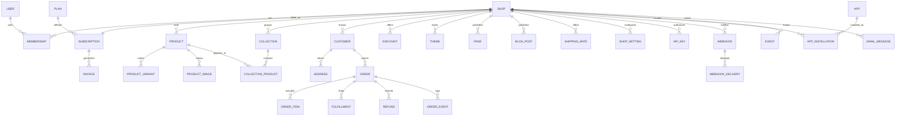

# Reverse Engineering Analysis (REA) — open-shopify

This document captures the analysis used to reconstruct a Shopify-like commerce platform from scratch. It describes the observable product model, the workflows that matter, the entities behind them, and how each decision maps into this repository. No proprietary source code, Liquid themes or brand assets were copied; the analysis is behavioral and the implementation is original.

## 1. Method

1. **Surface inventory** — enumerate the product surfaces a merchant and customer touch: marketing/auth, admin, online store, checkout, platform API, webhooks, apps, billing, settings.
2. **Entity extraction** — derive the persistent nouns from those workflows (shop, product, variant, order, fulfillment, refund, discount, theme, subscription...).
3. **State modelling** — capture statuses and transitions for orders, subscriptions and themes; note what gates each transition.
4. **Rules & invariants** — identify pricing order, plan limits, tenancy scoping and permission boundaries.
5. **Reconstruction** — implement the smallest coherent slice per surface while preserving cross-surface invariants (e.g. server-repriced checkout, scoped API tokens, owner-only billing).
6. **Verification** — typecheck, unit tests, production build, and end-to-end smoke flows against seeded data.

## 2. Surfaces observed

| Surface | Key behaviors |
| --- | --- |
| Marketing & auth | Landing page, trial signup, login, session persistence, store switcher redirect |
| Admin home | Sales summary, recent orders, inventory alerts, setup checklist |
| Orders | Filterable list, detail, payment/fulfillment statuses, fulfillment, refunds, cancel + restock, notes, timeline, packing slip |
| Products | List/search/filter, create/edit with variants, inventory, images, tags, vendor/type, status lifecycle |
| Collections | Manual curation and automated rule-based membership |
| Customers | Search, profiles, addresses, spend/count rollups, notes, marketing opt-in |
| Discounts | Types, minimums, schedules, usage caps, per-customer caps, enable/disable |
| Content | Pages and blog with drafts/publishing |
| Online store | Theme library, publish, customizer, preview, theme settings persisted as JSON |
| Apps | Directory, install/uninstall, capability flags that add storefront features |
| Analytics | Revenue trend, funnel, top products, most viewed, event stream |
| Settings | Store profile, currency/locale, payments, taxes, shipping, notifications, staff, API keys, webhooks |
| Billing | Trials, plan changes, usage against limits, invoices, cancellation and reactivation |
| Storefront | Themed home, collections, product detail, search, cart, journal, pages, order lookup |
| Checkout | Contact/address, shipping method, discounts, tax, payment simulation, confirmation |
| Platform API | Token-authenticated REST for shop, products, orders |
| Webhooks | Topic subscriptions, HMAC signing, delivery logging |

## 3. Domain model

### Modelling notes

- **Tenancy first.** Every commerce entity carries `shopId`. All admin queries derive it from the authenticated route slug; storefront and API queries derive it from the slug or token. There is no global product namespace.
- **Money is integer cents.** Display formatting is centralized. Checkout recomputes every amount server-side from database prices; the client cart is only a request.
- **Statuses are strings.** `financialStatus`, `fulfillmentStatus`, subscription status, review status, etc. use portability-friendly strings instead of database enums, so the schema runs on SQLite and PostgreSQL without migrations. The trade-off is that validation lives in application code.
- **JSON as text.** Theme configs, collection rules, variant options, addresses and event payloads are stored as serialized JSON strings. Helpers parse defensively and fall back to defaults.
- **Snapshot order lines.** `OrderItem` copies title, variant title, SKU, image, price and line total. Products can change or disappear without rewriting history.
- **Subscription is one-to-one with shop.** There is exactly one current subscription and plan per store in this reconstruction; plan changes update it and append invoices rather than creating new subscription records.

## 4. Identity, roles and tenancy

- A **User** can belong to multiple shops through **Membership** (`OWNER` or `STAFF`). Signup creates both the user and the shop with an owner membership and trial subscription.
- Sessions are stateless JWTs stored in an `httpOnly` cookie (`os_session`), signed with `AUTH_SECRET` via `jose`.
- `requireShop(slug)` loads the shop + subscription + plan, verifies membership, and redirects non-members to their first shop (or signup). `requireShop(slug, { owner: true })` additionally protects settings, team management, API keys, webhooks and billing.
- Staff see the operational admin (home, orders, products, collections, customers, discounts, content, themes, apps, analytics) but not the Settings section in navigation. Action handlers re-check owners server-side, so hidden UI is not the security boundary.
- Accessing a shop you do not belong to falls back to a shop you do belong to, rather than leaking existence or data.

## 5. Admin workflows

### Product lifecycle

`DRAFT → ACTIVE → ARCHIVED`. Product create/update accepts variants with price, compare-at price, cost, SKU, inventory, weight, shipping/tax flags and option JSON. Handles are slugged and unique per shop. Variants are replaced transactionally on edit by the form action. Inventory alerts compare variant quantities to the shop's low-stock threshold. Storefront only renders `ACTIVE` products.

### Collections

- **Manual** collections link products explicitly with an ordering position.
- **Automated** collections store rule JSON (`productType`, `vendor`, `tag`, `priceMin`, `priceMax`). Matching is evaluated at read time, case-insensitively, with min-variant price used for price bounds.
- `/collections/all` is virtual and always reflects all active products, sorted in-app.

### Order lifecycle

Observed statuses:

- `financialStatus`: `PENDING → AUTHORIZED → PAID → PARTIALLY_REFUNDED → REFUNDED`, plus `VOIDED` and `CANCELLED`.
- `fulfillmentStatus`: `UNFULFILLED → FULFILLED`.

Transitions implemented as server actions:

- **Mark as paid** (`PENDING/AUTHORIZED → PAID`), appending a timeline event and webhook.
- **Fulfill** — optionally capturing tracking company/number, creating a `Fulfillment`, switching to `FULFILLED`, queueing the shipping email, dispatching `orders/fulfilled`.
- **Refund** — partial or full amount, updating financial status and customer spend semantics, logging refund and timeline.
- **Cancel** — sets `CANCELLED`, restores tracked inventory, appends a timeline note and dispatches `orders/cancelled`.
- **Notes** — internal notes and manual timeline entries.
- **Packing slip** — print-optimized route with no admin chrome.

Order numbers are per-shop sequential integers starting at 1001 in the seed. The checkout action uses max + 1; a production build would use a guarded sequence to avoid races.

### Discounts

Three kinds: `PERCENTAGE`, `FIXED` (cents off subtotal) and `FREE_SHIPPING` (zeroes the shipping line). Validation order: existence → status → start date → end date → usage cap → minimum subtotal. At checkout, per-customer limits are additionally checked by counting prior orders with the same email and code. Applying an order increments `usedCount`.

### Themes

Shopify's Liquid theme system is replaced with a structured JSON **ThemeConfig** (colors, font stacks, hero, announcement, footer, nav) plus three presets: Dawn, Spotlight, Organic. Admins can create a theme from a preset, customize colors/fonts/content/image, preview it live in the customizer, and publish it. Exactly one theme is `MAIN`; the storefront resolves `MAIN` (falling back to the oldest theme). Config is re-validated through `parseThemeConfig`, which deep-merges over defaults so partial or corrupt JSON cannot break rendering. CSS variables (`--os-*`) carry the theme into storefront primitives.

### Apps

Apps declare capability strings (`reviews`, `newsletter`). Installing an app activates storefront behavior: Judge.me or Fera adds review display and submission; Klaviyo adds the footer newsletter form. Uninstalling removes the behavior without deleting historical data. The app directory also shows category, rating, installs and pricing labels.

### Settings and team

Settings are key/value rows (`ShopSetting`) parsed into a typed `ShopSettings` object with defaults. Covered: payment method availability, tax rate and whether shipping is taxed, checkout note, low-stock threshold, newsletter switch, and four email templates with `{{placeholder}}` substitution.

Shipping rates are shop-scoped rows with a price and an optional free-over subtotal. Staff invitations create a user (or attach an existing user) with a hashed temporary password. Seat counts are checked against the current plan's `staffLimit` before adding. Owners cannot be removed.

### Billing

Plans encode limits and economics: monthly price, trial days, product limit, staff limit, third-party transaction fee (bps), card rate (bps + fixed cents), and marketing features.

Observed rules reconstructed:

- New shops start `TRIALING` for 14 days.
- Plan change is owner-only. Downgrades are rejected if current product or staff counts exceed the target limits; the error explains exactly how many items/seats must be removed.
- Changing plans mid-trial keeps the trial; outside a trial it starts a new 30-day period and appends a paid invoice.
- Cancelling sets `CANCELLED`; the storefront renders a closed page and checkout refuses orders. Reactivation starts a new period and invoice.
- Invoices are sequentially numbered (`INV-1001`, ...), with period start/end, amount and status.

## 6. Storefront and checkout

### Rendering

The storefront layout loads the shop with subscription, themes, settings and active app installs in one cached query per request. It wraps pages in a cart provider and renders announcement bar, brand, theme nav, search, cart badge, footer, newsletter and help links. If the subscription is cancelled, the layout short-circuits to a themed "store is closed" screen.

Theme variation is applied via CSS custom properties: `--os-primary`, `--os-bg`, `--os-surface`, `--os-text`, `--os-muted`, `--os-border`, `--os-accent`, `--os-font-heading`, `--os-font-body`. Component classes (`.store-btn`, `.store-card`, `.store-input`...) consume them, so all three presets — including the dark Spotlight theme — work without duplicated Tailwind palettes.

### Cart

The cart is client-side state persisted to `localStorage` per shop (`os_cart_<slug>`). It stores a price snapshot for display, but checkout ignores those prices: the server refetches every variant by ID, verifies it belongs to the shop and is active, clamps quantities, and rejects unavailable or insufficient stock. This mirrors the real-world invariant that client input is untrusted.

### Checkout pipeline

1. Validate contact and shipping fields.
2. Parse cart line references; fetch variants + products; reject missing, inactive, out-of-stock or over-quantity lines.
3. Compute subtotal from database prices.
4. Validate discount code against status/schedule/minimum/usage and per-customer rule; compute discount amount (free-shipping discounts zero shipping).
5. Resolve the chosen active shipping rate; apply free-over threshold based on subtotal. If no rates exist, shipping is free.
6. Compute tax on `(subtotal − discount) + (taxShipping ? shipping : 0)` at the shop's flat rate.
7. Upsert customer and address.
8. Create order + items + timeline atomically via nested create; allocate the next per-shop order number.
9. Decrement tracked inventory, increment discount usage, increment customer spend/order count.
10. Record `order_completed`, queue the templated confirmation email, dispatch `orders/create` and (if card) `orders/paid`, plus `customers/create` for first-time buyers.
11. Return the order number; the client clears the cart and navigates to the receipt.

Card payments are simulated and immediately `PAID`; manual payments create `PENDING` orders with instructions implied by the template. Discount codes can be previewed through a server action so the summary updates before submission, but the authoritative calculation happens again in `placeOrder`.

### Receipt and lookup

The thank-you page renders the order, item snapshots, totals, shipping address, payment/delivery status, clears the client cart, and links to lookup. Lookup requires both order number and matching email, avoiding enumerable receipts.

## 7. Analytics and events

A lightweight event stream records `product_viewed`, `checkout_started`, `order_completed`, `search` and `newsletter_signup`, with optional integer value and JSON payload. Client components fire view/checkout events through a guarded server action (once per mount); the checkout action records completion server-side.

The admin analytics page uses order and event data to compute:

- Net sales = paid order totals − refunds in range;
- Paid orders, AOV, conversion (paid orders ÷ checkouts started);
- Daily revenue series for 7/30/90 days;
- Top products by revenue from order item snapshots;
- Most viewed products by parsing event payload handles;
- Event counts and recent activity.

This is intentionally aggregate-on-read: no separate warehouse, suitable for demo scale.

## 8. Platform API and webhooks

### API

`authenticateApiRequest` accepts `Authorization: Bearer <token>` or `X-Open-Shopify-Access-Token`. Keys are shop-scoped, carry comma-separated scopes (`read_products`, `write_products`, `read_orders`), and update `lastUsedAt`. Endpoints:

- `GET /api/v1/shop` — shop profile + plan + key scopes.
- `GET /api/v1/products` — filter by status/query, limit up to 250; returns variants and cents pricing.
- `POST /api/v1/products` — zod-validated create, unique handle generation, default variant fallback.
- `GET /api/v1/orders` — filter by financial status, includes customer, items and refunds.
- `GET /api/health` — app/database status.

Errors follow a simple `{ errors: string | string[] }` shape with 400/401/403/422 statuses.

### Webhooks

Topics cover order, product, customer and app lifecycle. Delivery:

- JSON body `{ topic, shop, triggered_at, data }`;
- Headers `X-Open-Shopify-Topic` and `X-Open-Shopify-Hmac-Sha256`;
- HMAC-SHA256 over the exact body with the webhook secret;
- 5-second timeout, never blocking the primary mutation on delivery failure;
- `WebhookDelivery` rows record response code or error for the admin log.

The settings UI can create, enable/disable, delete and send a test delivery.

## 9. Design system

- **Admin**: light slate shell, dark sidebar, emerald primary, dense tables, status badges, stat cards, summary charts, print styles. Pages use shared primitives (`PageHeader`, `Banner`, `StatCard`, `EmptyState`, `SettingsTabs`, `RevenueChart`, `Stars`, `StatusBadge`).
- **Storefront**: theme-driven, content-first. Hero, editorial grids, rounded cards, generous whitespace, responsive product grids, consistent form primitives.
- **Assets**: product/hero imagery is generated SVG (gradients + shapes) so the repo is self-contained and deterministic; regenerate with `node scripts/gen-assets.mjs`.

## 10. Mapping decisions and deliberate divergences

| Shopify concept | Reconstruction | Reason |
| --- | --- | --- |
| Liquid themes + sections | JSON theme config + presets + CSS vars | Captures theming behavior without a template engine or arbitrary code execution |
| Payment provider integrations | Simulated card/manual methods | No secrets, no external accounts, deterministic tests |
| Transactional email delivery | `EmailMessage` outbox | Observable templates without SMTP |
| Background jobs | Inline actions | Demo scale; no worker infrastructure |
| Region-aware taxes | Flat rate + optional shipping tax | Keeps checkout math testable; documented as a limit |
| Metafields / metaobjects | Not implemented | Out of scope for the core commerce slice |
| Multi-currency presentment | Single shop currency | Checkout and reporting stay coherent |
| Marketing automation | Newsletter signup event + marketing opt-in | Demonstrates app capability gating |
| Shopify Plus org features | Plan record + limits only | Demonstrates plan-gated economics |

Known limitations are tracked in the README: simulated payments/emails, best-effort inventory decrement, no media uploads, limited API surface, and no migration history.

## 11. Verification

- `npm run typecheck` — strict TypeScript across routes, actions and libraries.
- `npm test` — Vitest covers money parsing/formatting, discount validation and math, totals with tax/shipping, plan limits and fee formatting, collection rules, theme merging and CSS vars, slugging and template rendering.
- `npm run build` — Prisma client generation + Next.js production build.
- Manual smoke path: landing → login → dashboard → products/orders/settings/billing; storefront home → collection → product → add to cart → checkout with `WELCOME10` → receipt → admin order appears with timeline, inventory decrement, email outbox entry and analytics events; API key request against `/api/v1/products`; webhook test delivery.
